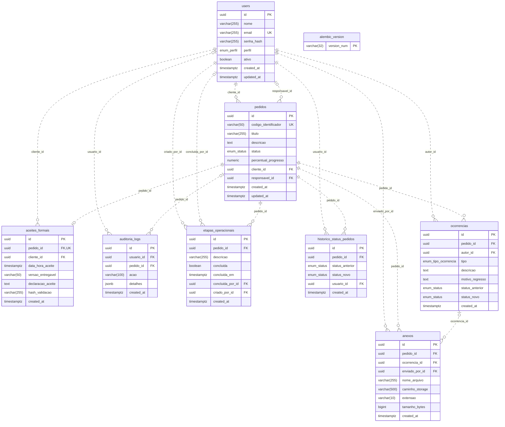
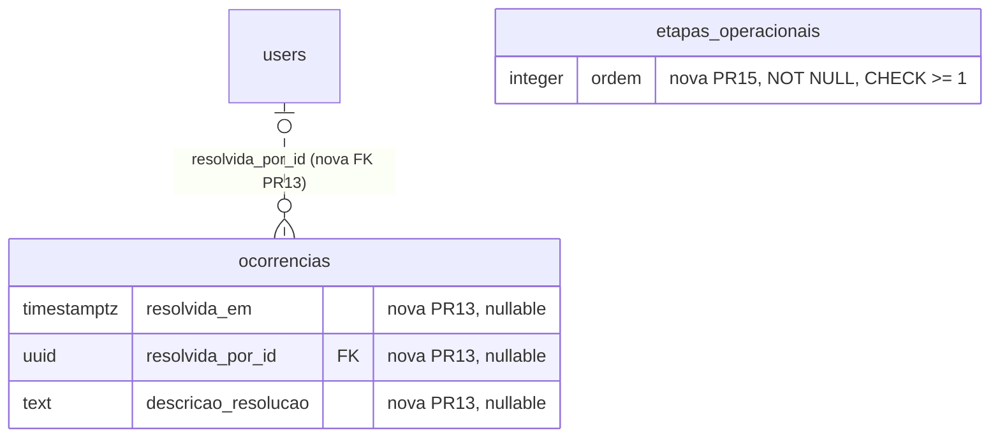

# DER — Automatize

Auditoria de 2026-11-05. Schema do PR #14: `Henrique-Silva`, commit `3ef5080daba43ba1f1fd83100a61219542c22146`, Alembic `d8f4a2c6e901`. Fonte: todos os oito models de `app/domain/models/` e as oito migrations de `alembic/versions/`. O catálogo PostgreSQL descartável foi conferido com `alembic check`.

Este documento descreve o código e o banco descartável, não afirma implantação no Supabase. São oito tabelas de domínio e uma tabela de infraestrutura. `demanda` é o nome usado pela API para `pedidos`; não existe outra tabela `demandas`. Não existem tabelas próprias de sessão, JWT, perfil, bucket ou fila de limpeza neste schema.

## Diagrama do PR #14

`||` = exatamente um; `o|` = zero ou um; `o{` = zero ou muitos. Linhas tracejadas representam relacionamentos não identificadores: a FK não compõe a PK do filho. As ligações descrevem FKs; papéis de negócio são validados pelos services. O FK composto de anexos complementa a ligação com ocorrências e é detalhado abaixo.



## Tipos e convenções

Todos os IDs de domínio são UUID com default `gen_random_uuid()`. PK implica NOT NULL. A tabela `alembic_version` tem PK textual `version_num VARCHAR(32) NOT NULL`, sem default e sem FK; não pertence ao ORM de domínio.

No catálogo criado do zero, as PKs de domínio têm nome `<tabela>_pkey`;
a PK da infraestrutura é `alembic_version_pkc`. PKs e UNIQUEs criam seus índices
únicos automaticamente; os índices adicionais não únicos estão listados abaixo.
Esses nomes foram conferidos no PostgreSQL descartável, sem presumir igualdade
com nomes eventualmente atribuídos manualmente no Supabase.

| Enum PostgreSQL | Valores persistidos |
| --- | --- |
| enum_perfil | ADMIN, CLIENTE, TECNICO |
| enum_status | PLANEAMENTO, EXECUCAO, HOMOLOGACAO, CONCLUIDO |
| enum_tipo_ocorrencia | ERRO, SOLICITACAO_CORRECAO, REGRESSO_ESTADO |

`TIMESTAMP WITH TIME ZONE` corresponde a timestamptz. `updated_at` de users/pedidos usa `onupdate=now()` no SQLAlchemy; não existe trigger SQL geral para atualizar esse campo. Defaults não tornam uma coluna NOT NULL. CHECK com expressão nula segue a semântica PostgreSQL.

## Dicionário de colunas do PR #14

### public.aceites_formais

| Coluna | Tipo PostgreSQL | Nulo? | Chaves | Default SQL |
| --- | --- | --- | --- | --- |
| id | `UUID` | não | PK | `gen_random_uuid()` |
| pedido_id | `UUID` | não | FK, UNIQUE | — |
| cliente_id | `UUID` | não | FK | — |
| data_hora_aceite | `TIMESTAMP WITH TIME ZONE` | não | — | `CURRENT_TIMESTAMP` |
| versao_entregavel | `VARCHAR(50)` | não | — | — |
| declaracao_aceite | `TEXT` | não | — | — |
| hash_validacao | `VARCHAR(255)` | não | — | — |
| created_at | `TIMESTAMP WITH TIME ZONE` | sim | — | `CURRENT_TIMESTAMP` |

Restrições adicionais:

- UNIQUE `uq_aceites_formais_pedido_id`: `pedido_id`.

### public.anexos

| Coluna | Tipo PostgreSQL | Nulo? | Chaves | Default SQL |
| --- | --- | --- | --- | --- |
| id | `UUID` | não | PK | `gen_random_uuid()` |
| pedido_id | `UUID` | não | FK, FK composto | — |
| ocorrencia_id | `UUID` | sim | FK, FK composto | — |
| enviado_por_id | `UUID` | não | FK | — |
| nome_arquivo | `VARCHAR(255)` | não | — | — |
| caminho_storage | `VARCHAR(500)` | não | — | — |
| extensao | `VARCHAR(10)` | não | — | — |
| tamanho_bytes | `BIGINT` | não | — | — |
| created_at | `TIMESTAMP WITH TIME ZONE` | sim | — | `CURRENT_TIMESTAMP` |

Restrições adicionais:

- Nenhum UNIQUE ou CHECK adicional declarado.

### public.auditoria_logs

| Coluna | Tipo PostgreSQL | Nulo? | Chaves | Default SQL |
| --- | --- | --- | --- | --- |
| id | `UUID` | não | PK | `gen_random_uuid()` |
| usuario_id | `UUID` | sim | FK | — |
| pedido_id | `UUID` | sim | FK | — |
| acao | `VARCHAR(100)` | não | — | — |
| detalhes | `JSONB` | sim | — | — |
| created_at | `TIMESTAMP WITH TIME ZONE` | sim | — | `CURRENT_TIMESTAMP` |

Restrições adicionais:

- Nenhum UNIQUE ou CHECK adicional declarado.

### public.etapas_operacionais

| Coluna | Tipo PostgreSQL | Nulo? | Chaves | Default SQL |
| --- | --- | --- | --- | --- |
| id | `UUID` | não | PK | `gen_random_uuid()` |
| pedido_id | `UUID` | não | FK | — |
| descricao | `VARCHAR(255)` | não | — | — |
| concluida | `BOOLEAN` | não | — | `false` |
| concluida_em | `TIMESTAMP WITH TIME ZONE` | sim | — | — |
| concluida_por_id | `UUID` | sim | FK | — |
| criado_por_id | `UUID` | não | FK | — |
| created_at | `TIMESTAMP WITH TIME ZONE` | não | — | `CURRENT_TIMESTAMP` |

Restrições adicionais:

- CHECK `etapas_operacionais_conclusao_check`: `(concluida AND concluida_em IS NOT NULL AND concluida_por_id IS NOT NULL) OR (NOT concluida AND concluida_em IS NULL AND concluida_por_id IS NULL)`.
- Índice `ix_etapas_operacionais_pedido_id`: `pedido_id`.

### public.historico_status_pedidos

| Coluna | Tipo PostgreSQL | Nulo? | Chaves | Default SQL |
| --- | --- | --- | --- | --- |
| id | `UUID` | não | PK | `gen_random_uuid()` |
| pedido_id | `UUID` | não | FK | — |
| status_anterior | `enum_status` | não | — | — |
| status_novo | `enum_status` | não | — | — |
| usuario_id | `UUID` | não | FK | — |
| created_at | `TIMESTAMP WITH TIME ZONE` | não | — | `CURRENT_TIMESTAMP` |

Restrições adicionais:

- Nenhum UNIQUE ou CHECK adicional declarado.
- Índice `ix_historico_status_pedidos_pedido_id`: `pedido_id`.
- Índice `ix_historico_status_pedidos_usuario_id`: `usuario_id`.

### public.ocorrencias

| Coluna | Tipo PostgreSQL | Nulo? | Chaves | Default SQL |
| --- | --- | --- | --- | --- |
| id | `UUID` | não | PK, UNIQUE composto | `gen_random_uuid()` |
| pedido_id | `UUID` | não | FK, UNIQUE composto | — |
| autor_id | `UUID` | não | FK | — |
| tipo | `enum_tipo_ocorrencia` | não | — | — |
| descricao | `TEXT` | não | — | — |
| motivo_regresso | `TEXT` | sim | — | — |
| status_anterior | `enum_status` | sim | — | — |
| status_novo | `enum_status` | sim | — | — |
| created_at | `TIMESTAMP WITH TIME ZONE` | sim | — | `CURRENT_TIMESTAMP` |

Restrições adicionais:

- UNIQUE `uq_ocorrencias_id_pedido_id`: `id, pedido_id`.

### public.pedidos

| Coluna | Tipo PostgreSQL | Nulo? | Chaves | Default SQL |
| --- | --- | --- | --- | --- |
| id | `UUID` | não | PK | `gen_random_uuid()` |
| codigo_identificador | `VARCHAR(50)` | não | UNIQUE | — |
| titulo | `VARCHAR(255)` | não | — | — |
| descricao | `TEXT` | sim | — | — |
| status | `enum_status` | não | — | `'PLANEAMENTO'::enum_status` |
| percentual_progresso | `NUMERIC(5, 2)` | sim | — | `0.00` |
| cliente_id | `UUID` | não | FK | — |
| responsavel_id | `UUID` | sim | FK | — |
| created_at | `TIMESTAMP WITH TIME ZONE` | sim | — | `CURRENT_TIMESTAMP` |
| updated_at | `TIMESTAMP WITH TIME ZONE` | sim | — | `CURRENT_TIMESTAMP` |

Restrições adicionais:

- CHECK `pedidos_percentual_progresso_check`: `percentual_progresso >= 0 AND percentual_progresso <= 100`.
- UNIQUE `pedidos_codigo_identificador_key`: `codigo_identificador`.

### public.users

| Coluna | Tipo PostgreSQL | Nulo? | Chaves | Default SQL |
| --- | --- | --- | --- | --- |
| id | `UUID` | não | PK | `gen_random_uuid()` |
| nome | `VARCHAR(255)` | não | — | — |
| email | `VARCHAR(255)` | não | UNIQUE | — |
| senha_hash | `VARCHAR(255)` | não | — | — |
| perfil | `enum_perfil` | não | — | `'CLIENTE'::enum_perfil` |
| ativo | `BOOLEAN` | sim | — | `true` |
| created_at | `TIMESTAMP WITH TIME ZONE` | sim | — | `CURRENT_TIMESTAMP` |
| updated_at | `TIMESTAMP WITH TIME ZONE` | sim | — | `CURRENT_TIMESTAMP` |

Restrições adicionais:

- UNIQUE `users_email_key`: `email`.

## FKs e exclusão

Todas as FKs usam ON UPDATE NO ACTION. NO ACTION é o comportamento padrão quando a migration não declara ON DELETE. Relacionamentos são não identificadores: as FKs não compõem as PKs dos filhos.

| Constraint | Origem | Destino | ON DELETE | Adiamento |
| --- | --- | --- | --- | --- |
| aceites_formais_cliente_id_fkey | aceites_formais.(cliente_id) | users.id | NO ACTION | imediato |
| aceites_formais_pedido_id_fkey | aceites_formais.(pedido_id) | pedidos.id | NO ACTION | imediato |
| anexos_enviado_por_id_fkey | anexos.(enviado_por_id) | users.id | NO ACTION | imediato |
| anexos_ocorrencia_id_fkey | anexos.(ocorrencia_id) | ocorrencias.id | SET NULL | imediato |
| anexos_pedido_id_fkey | anexos.(pedido_id) | pedidos.id | CASCADE | imediato |
| fk_anexos_ocorrencia_pedido | anexos.(ocorrencia_id, pedido_id) | ocorrencias.id, ocorrencias.pedido_id | NO ACTION | DEFERRABLE INITIALLY DEFERRED |
| auditoria_logs_pedido_id_fkey | auditoria_logs.(pedido_id) | pedidos.id | SET NULL | imediato |
| auditoria_logs_usuario_id_fkey | auditoria_logs.(usuario_id) | users.id | SET NULL | imediato |
| etapas_operacionais_concluida_por_id_fkey | etapas_operacionais.(concluida_por_id) | users.id | NO ACTION | imediato |
| etapas_operacionais_criado_por_id_fkey | etapas_operacionais.(criado_por_id) | users.id | NO ACTION | imediato |
| etapas_operacionais_pedido_id_fkey | etapas_operacionais.(pedido_id) | pedidos.id | CASCADE | imediato |
| fk_historico_status_pedido | historico_status_pedidos.(pedido_id) | pedidos.id | CASCADE | imediato |
| fk_historico_status_usuario | historico_status_pedidos.(usuario_id) | users.id | NO ACTION | imediato |
| ocorrencias_autor_id_fkey | ocorrencias.(autor_id) | users.id | NO ACTION | imediato |
| ocorrencias_pedido_id_fkey | ocorrencias.(pedido_id) | pedidos.id | CASCADE | imediato |
| pedidos_cliente_id_fkey | pedidos.(cliente_id) | users.id | NO ACTION | imediato |
| pedidos_responsavel_id_fkey | pedidos.(responsavel_id) | users.id | NO ACTION | imediato |

São 17 constraints de FK (18 componentes escalares). `fk_anexos_ocorrencia_pedido` garante que a ocorrência opcional pertença ao mesmo pedido. É DEFERRABLE INITIALLY DEFERRED para coexistir com o FK simples `ocorrencia_id ON DELETE SET NULL`. `uq_ocorrencias_id_pedido_id` fornece a chave candidata composta; não significa várias ocorrências com o mesmo ID.

`caminho_storage` não tem UNIQUE nem FK SQL para `storage.objects`. `tamanho_bytes` não tem CHECK SQL de tamanho. Validação estrutural/MIME, limite de arquivo e autorização horizontal estão na aplicação. Exclusão SQL em cascata remove metadados; não remove bytes no Storage. Os schemas geridos `storage` e `auth` não são criados por estas migrations e não se inventa relacionamento com eles.

## Regras que não são relacionamentos

- SCRUM-71: entrada em HOMOLOGACAO exige pelo menos uma etapa e todas concluídas. Regra compartilhada pelos services, com bloqueio do pedido; não existe trigger SQL que imponha esse checklist a um owner escrevendo SQL arbitrário.
- `trg_aceites_formais_imutavel`: impede UPDATE/DELETE de aceite; UNIQUE permite no máximo um aceite por pedido. FK não comprova, por si só, que cliente_id tenha perfil CLIENTE ou seja o cliente do pedido; essa verificação é da aplicação.
- `trg_pedidos_protege_conclusao`: exige aceite ao entrar em CONCLUIDO e bloqueia UPDATE/DELETE de pedido já concluído.
- `trg_auditoria_logs_imutavel`: bloqueia adulteração/exclusão do payload, com exceção restrita para SET NULL executado pelas FKs ao excluir pais. Histórico depende das permissões e dos caminhos autorizados; não possui trigger append-only equivalente.
- As três funções são SECURITY INVOKER, com `search_path=pg_catalog, pg_temp` e tabelas `public.*` qualificadas; EXECUTE público/anon/authenticated revogado.
- RLS ativo nas nove tabelas, sem FORCE RLS e sem criação de policies permissivas. Data API anon/authenticated perde grants de tabela e coluna; owner/BYPASSRLS continua sendo fronteira privilegiada. Storage não é alterado por essas migrations.

## Evolução por revisão

| Revisão | Schema / proteção introduzida |
| --- | --- |
| fbfba8e84540 | users, pedidos, ocorrencias, anexos, aceites_formais, auditoria_logs e enums |
| a4fa37701385 | revisão sem operação adicional |
| fd3fe1dcfeab | historico_status_pedidos e índices |
| 3c9e7a1b5d20 | etapas_operacionais, UNIQUE do aceite e duas triggers de imutabilidade/conclusão |
| 7b2d4e6f8a10 | RLS nas nove tabelas, inclusive alembic_version |
| 9d4f2a6c8e11 | search_path seguro e REVOKE da Data API |
| b6e1c8a4d230 | imutabilidade da auditoria |
| d8f4a2c6e901 | FK composto anexo/ocorrência e chave candidata |

A migration inicial tem o mesmo ID, mas era baseline sem DDL na main. Seu conteúdo atual também está na HML. Nunca inferir igualdade de schema somente pelo rótulo Alembic; conferir catálogo e histórico antes do deploy. Não reaplicar a inicial sobre tabelas existentes.

## Schema proposto com PRs #13 e #15

Comparação somente leitura; nenhuma integração realizada. PR #13 (`Luis-Santini`, `e63b0e52707ad6bbbe4cd5a8c596408f1b53dc67`) já contém o HEAD do PR #14. PR #15 (`fix/api-finalizacao-20261103`, `df6f3b4ea944e4082da196162a10f4b7dc44f5b5`) deriva desse HEAD do Luís. Nenhuma migration compartilhada possui conteúdo divergente entre esses três HEADs.

```text
d8f4a2c6e901 (PR14)
  -> e3b7c1d9f402 (PR13: resolução de ocorrências)
  -> f9a2d4c6b803 (PR15: ordem das etapas)
```

| PR / tabela | Coluna nova | Tipo | Nulo? | FK / default |
| --- | --- | --- | --- | --- |
| #13 ocorrencias | resolvida_em | timestamptz | sim | — |
| #13 ocorrencias | resolvida_por_id | UUID | sim | users.id, ON DELETE/UPDATE NO ACTION |
| #13 ocorrencias | descricao_resolucao | TEXT | sim | — |
| #15 etapas_operacionais | ordem | INTEGER | não | default 1 |

PR #13 adiciona CHECK `ck_ocorrencias_resolucao_completa`: `(resolvida_em IS NULL) = (resolvida_por_id IS NULL) AND (resolvida_em IS NULL) = (descricao_resolucao IS NULL)`. Os três campos ficam todos nulos ou todos preenchidos. A propriedade `resolvida` é calculada, não uma coluna. A nova FK é `fk_ocorrencias_resolvida_por_id_users`, cardinalidade users zero/um por ocorrência e zero/muitas ocorrências por usuário.

PR #15 preenche `ordem` com `row_number() OVER (PARTITION BY pedido_id ORDER BY created_at,id)`, depois NOT NULL/default 1/CHECK `ck_etapas_ordem_positiva (ordem >= 1)`. Não há UNIQUE `(pedido_id,ordem)`. Serialização e reordenação são feitas pelo service com lock do pedido.



Este último diagrama mostra somente o delta; todas as colunas e relações anteriores permanecem. Nenhuma tabela nova é proposta pelos PRs #13/#15. A HML consultada (`f4f89e787cde2333f4b99696e7c9d15a61fdfabb`) termina em `7b2d4e6f8a10`; ainda não contém as três últimas revisões do PR #14 nem esses dois deltas.

A integração do Luís também acrescenta bloqueio por ocorrência aberta para homologação (SCRUM-98). Isso preserva o requisito das etapas, mas amplia o critério de negócio e precisa de aceite do responsável; não é apresentado como regra já existente no PR #14.

## Conferência da finalização de Henrique

Os oito models e as oito migrations foram relidos integralmente nesta rodada.
Nenhum model, enum, relacionamento ou migration foi alterado. O schema efetivo
da branch continua em `d8f4a2c6e901`. O PR14 permanece aberto, sem merge, conforme
consulta ao GitHub; as refs de HML/Luís/PR15 foram atualizadas sem checkout.

`scripts.schema_preflight` fornece conferência reproduzível do catálogo contra
manifesto obtido da mesma revisão em PostgreSQL isolado: colunas com compilação
de tipos PostgreSQL (preserva nomes dos enums), defaults, PK, UNIQUE, CHECK, FKs,
índices, enums, definições de funções e vínculo/ativação das triggers. Não
considera o rótulo Alembic suficiente e não altera o banco examinado. Testes
reproduzem o baseline histórico sem DDL e detectam divergência com o mesmo ID.

As diferenças propostas por Luís/Alisson acima continuam separadas do schema
efetivo. Os scripts operacionais novos e o ensaio de reconciliação não criam
tabelas, locks persistentes, outbox, policies ou executor de exclusão.
