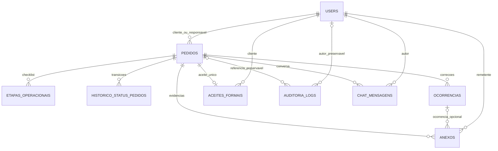

# Apresentação técnica de Henrique — Automatize — 10/11/2026

## Responsabilidades e autoria

Minha entrega concentra persistência e segurança das SCRUM-82, SCRUM-87 e
SCRUM-103: integridade de aceites/auditoria, FKs de anexos, migrations, RLS,
privilégios, reconciliação conservadora e testes PostgreSQL. Também consolidei
a validação e consulta de imagens e preparei esta integração para revisão.

Ciclo de vida, administração de usuários, fila, visualizações e o contrato de
chat publicado já vieram da HML e incluem trabalho dos outros integrantes.
Foram preservados e testados; não os apresento como implementação exclusiva
minha. No chat, esta integração acrescenta validação estrita do corpo e recarga
do vínculo sob lock, reaproveitando o contrato publicado.

## DER e principais tabelas



São dez tabelas de domínio na base integrada, incluindo `movimentos_quadro`,
que já existe na HML e não tem FK relacional ao pedido. `alembic_version` é
infraestrutura. Imagens ficam no Storage privado; `anexos` guarda metadados.
Não foi criada tabela duplicada nem coluna de imagem em BYTEA/Base64.

Dois vínculos compostos reforçam a integridade: anexo/ocorrência pertencem ao
mesmo pedido; o cliente do aceite é o cliente do pedido. Logs preservam o
payload quando uma manutenção permitida desassocia uma FK por SET NULL.

## SQLAlchemy, repositories e transações

Models descrevem tipos, FKs, checks e índices. Repositories consultam/persistem;
services autorizam e controlam commit/rollback. Os endpoints usam o usuário do
JWT, não IDs enviados no corpo para assumir identidade.

Locks de linha mantêm estáveis demanda, vínculo e estado durante operações
críticas. Upload não é uma transação distribuída com PostgreSQL: compensação
é limitada ao objeto recém-gerado; commit incerto conserva o objeto para revisão.

## Alembic e migrations

Head final local: **d1f6a8c20391**, descendente de **84db17ce9f26**. Acrescenta
FK composta de aceite/cliente e CHECK de conteúdo, sem reescrever as migrations
publicadas. Dados legados incompatíveis interrompem o upgrade sem reparo ou
remoção automática.

O chat usa a migration publicada `2a6d14c839ef`. A migration local alternativa
`c7a1e9b4d602` foi preservada na outra árvore e não entra nesta cadeia, pois
recriaria a mesma tabela. `heads`, `upgrade head`, `current` e `check` passaram
em PostgreSQL descartável. Não foi usado stamp.

## Segurança do PostgreSQL

RLS e grants são camadas diferentes. O domínio é acessado pela FastAPI via SQL,
com autorização por demanda. As roles `anon`/`authenticated` não recebem acesso
direto às tabelas internas. As funções de proteção usam SECURITY INVOKER e
search_path fixo. Não criamos policies permissivas genéricas.

Aceites e auditoria têm proteções contra UPDATE/DELETE proibidos; demandas
concluídas preservam sua imutabilidade. Owner/BYPASSRLS é uma fronteira
privilegiada e não substitui JWT/autorização da API.

## Anexos, imagens e chat

PNG/JPEG passam por validação de formato real e limite de 10 MiB; PDFs e
documentos já suportados continuam funcionando. Caminhos UUID e upsert=false
evitam sobrescrita. Antes de upload/assinatura, o backend confirma bucket privado.

`POST /demandas/{id}/evidencias`, `GET /demandas/{id}/anexos` e
`GET /demandas/{id}/anexos/{anexo_id}/acesso` são os contratos reaproveitados.
O link dura 300 segundos, sem cache/referrer; a chave não vai ao frontend.

O chat mantém `GET/POST /demandas/{id}/chat/{canal}`, paginação por cursor e
os participantes definidos pela HML: cliente/técnico no canal cliente;
admin/técnico no interno. Não foram criadas rotas duplicadas de chat.

## Testes e resultados desta integração

**932 passed, 0 failed, 0 errors, 0 skipped, 2 warnings**, em 185,27 segundos.
Inclui **331 testes PostgreSQL** e **18 casos da SCRUM-71**. Os demais testes
unitários/mocks/SQLite também foram mantidos, sem alegar que provam RLS.
Warnings são depreciações de Starlette/httpx e AnyIO.

O ensaio de apresentação passou separadamente: **1 passed**, dois warnings.
Também foram executados upgrade de schema antigo sintético, pg_dump/pg_restore
com ACLs/owners, comparação das onze tabelas protegidas e três triggers.

O download de PNG/JPEG foi validado com SHA-256 e decodificação, usando o
adapter real sobre provedor/HTTP controlado. Não é teste do Storage compartilhado.

## Demonstração reproduzível e segura

Pré-condições: Docker Desktop em execução, dependências da venv disponíveis e
porta local 55452 livre. Na pasta original `Automatize-Git`, executar:

```powershell
powershell -NoProfile -ExecutionPolicy Bypass -File ".pytest_tmp_apresentacao_20261110/integration/scripts/demo_apresentacao.ps1"
```

Em um checkout normal da branch, o caminho é `scripts/demo_apresentacao.ps1`.
O script localiza a venv do projeto, cria seu próprio PostgreSQL 17 em loopback,
configura só o processo, desabilita credenciais de Supabase nesse processo,
executa o teste demonstrativo e encerra apenas o contêiner criado por ele.
O Storage é simulado. Não imprime tokens, senhas ou strings de conexão.

O comando foi executado com sucesso. Uma primeira tentativa encontrou demora
de inicialização; a espera de prontidão foi corrigida para até 30 segundos e
validada novamente. Não é necessário improvisar credenciais do ambiente real.

## Roteiro de três minutos

| Tempo | Fala/ação |
| --- | --- |
| 0:00–0:20 | “Minha responsabilidade é persistência e segurança: proteger evidências, anexos, permissões e validar a integração.” |
| 0:20–0:45 | Mostrar o DER: demanda liga cliente, técnico, etapas, anexos e aceite; os bytes da imagem ficam fora do PostgreSQL. |
| 0:45–1:10 | Mostrar a head d1f e a FK composta; explicar imutabilidade, RLS/grants e que o banco compartilhado não foi alterado. |
| 1:10–2:15 | Executar o comando acima. Ler os cinco resultados: 401/404; chat e interno; PNG com link/bytes; etapas/aceite/conclusão; auditoria. |
| 2:15–2:40 | Mostrar a evidência sanitizada: 932 aprovados, 331 PostgreSQL e 18 SCRUM-71. Explicar que a suíte foi executada de novo nesta integração. |
| 2:40–3:00 | “A entrega está pronta para revisão e demo local. Faltam roles do Render, snapshot fiel e Storage real autorizado. Limpeza de órfãos continua desabilitada.” |

Se Docker/porta/venv não estiverem disponíveis, mostrar o ensaio já registrado
e a suíte executada, identificando-os como evidências locais; não simular sucesso
ao vivo ou dizer que houve implantação.

## Pendências e autoria da decisão operacional

O responsável pelo Render/Alisson precisa confirmar apenas os nomes das roles
de runtime e Alembic, seus privilégios e memberships. Não inferimos que sejam
postgres: esse nome foi medido apenas no cluster descartável.

Ainda são necessários snapshot fiel do principal com ACLs reais e validação
autorizada de upload/listagem/download no Storage do ambiente. Não houve
acesso ao Supabase compartilhado. SCRUM-87 permanece em dry-run: não há
coordenação global e remoção condicional por geração comprovadas.

Quatro commits locais organizam a entrega e o PR está descrito para HML.
Não houve push, abertura de PR ou merge. Publicação e rollout dependem de
autorização e revisão do diff concreto da integração. Nesta organização dos
commits, o código validado foi preservado e a suíte não foi reexecutada.
